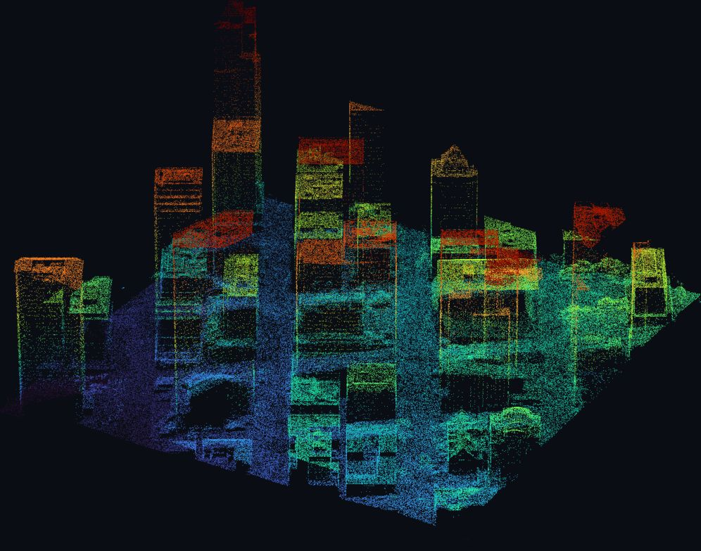
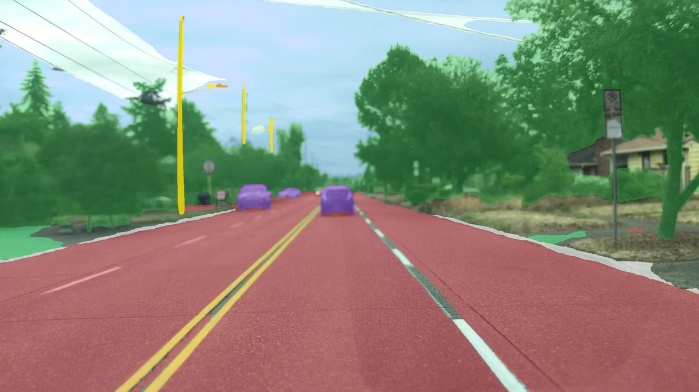
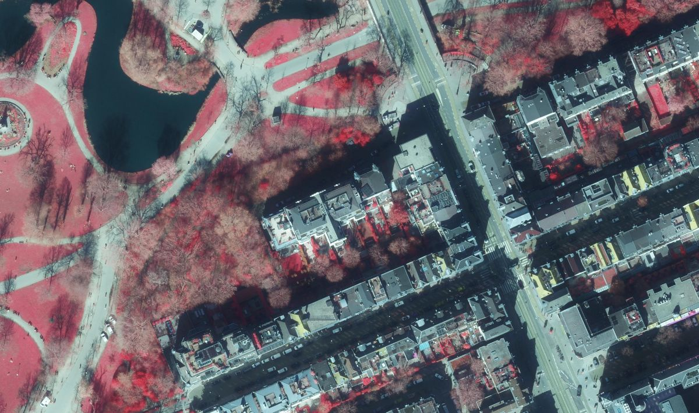
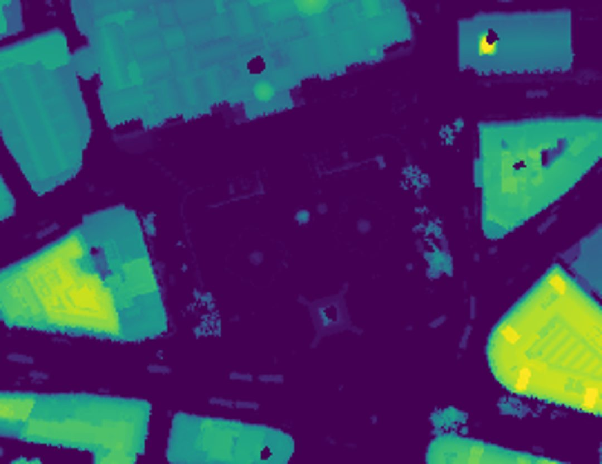
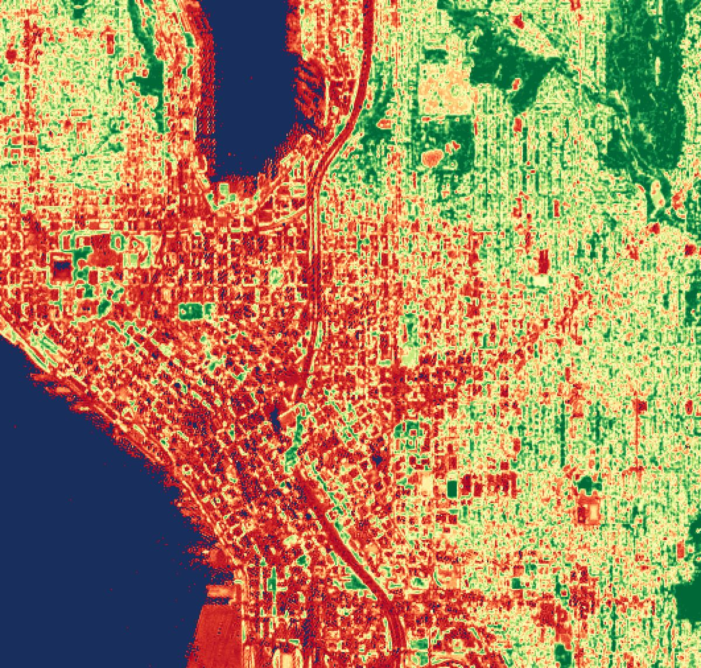
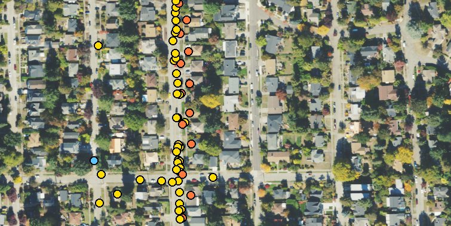
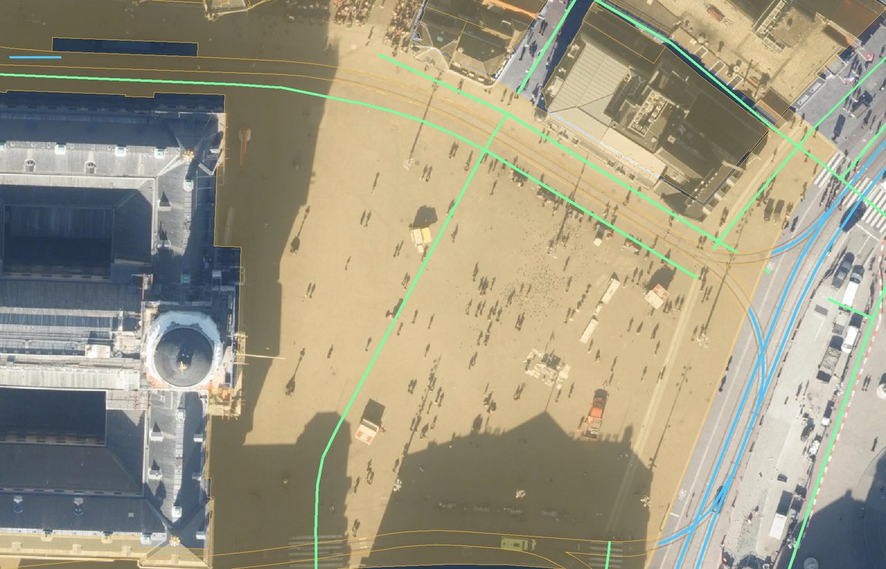
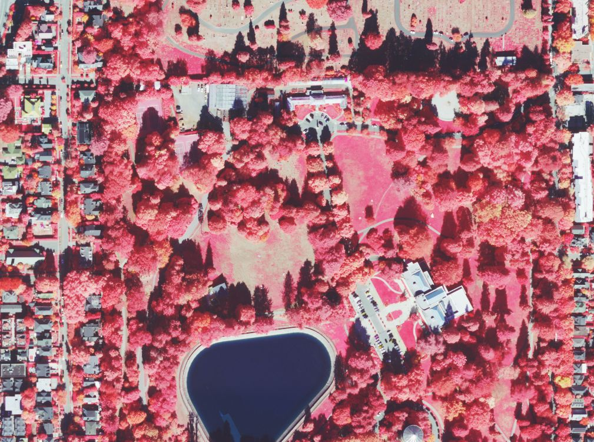
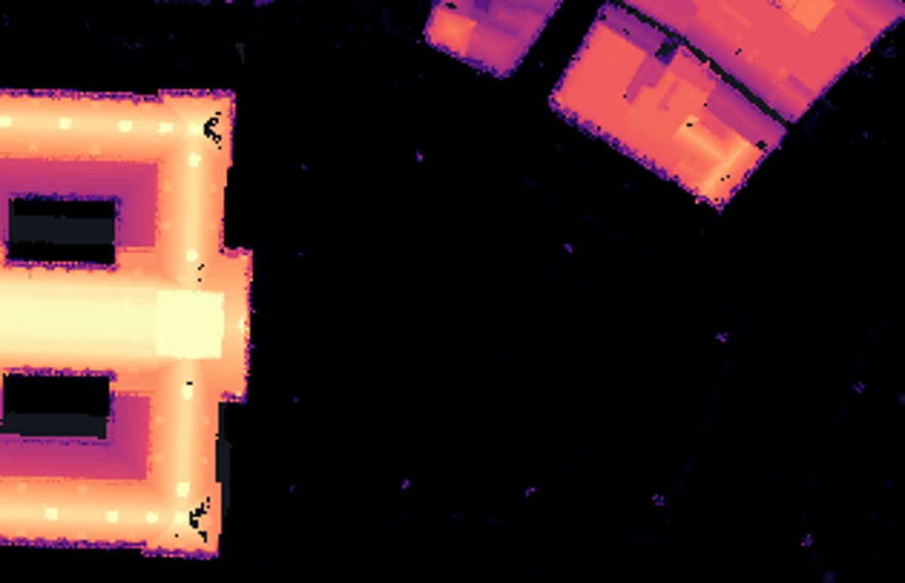

# mirrorworld

```{raw} html
<div class="mw-hero">
  
  <h1 class="mw-title">One place, every view.</h1>
  <p class="mw-tagline">
    Street-level panoramas, detected street assets, aerial and satellite imagery, elevation models,
    LiDAR point clouds and map data &mdash; for any point or bounding box, through one consistent Python API.
  </p>
  <div class="mw-install"><span>$</span> <b>pip install</b> mirrorworld</div>
  <div class="mw-badges">
    <a href="https://pypi.org/project/mirrorworld/"></a>
    <a href="https://pypi.org/project/mirrorworld/"></a>
    <a href="https://github.com/alienpenguin10/Mirrorworld/actions/workflows/python-test.yml"></a>
    <a href="https://github.com/alienpenguin10/Mirrorworld/blob/main/LICENSE"></a>
  </div>
  <div class="mw-cta">
    <a class="primary" href="getting-started.html">Get started &rarr;</a>
    <a class="ghost" href="recipes.html">Browse recipes</a>
    <a class="ghost" href="https://github.com/alienpenguin10/Mirrorworld">GitHub</a>
  </div>
</div>

<div class="mw-mosaic">
  <figure class="big"><figcaption><code>lidar.usgs3dep</code> &middot; downtown Seattle by height</figcaption></figure>
  <figure><figcaption><code>mapillary.get_detections()</code></figcaption></figure>
  <figure><figcaption><code>pdok</code> colour-infrared</figcaption></figure>
  <figure><figcaption><code>ea.get_ndsm()</code> &middot; London</figcaption></figure>
  <figure><figcaption><code>sentinel2</code> &middot; NDVI</figcaption></figure>
  <figure><figcaption><code>find_map_features()</code></figcaption></figure>
  <figure><figcaption><code>vector.osm</code> on 8 cm <code>pdok</code></figcaption></figure>
  <figure><figcaption><code>naip</code> &middot; near-infrared</figcaption></figure>
  <figure><figcaption><code>ahn.get_ndsm()</code> &middot; Amsterdam</figcaption></figure>
</div>
<p class="mw-credit">Every image above was fetched and rendered with mirrorworld &mdash; see <a href="about.html#image-credits">image credits</a>.</p>

<div class="mw-stats">
  <div><b>12</b><span>street-level services</span></div>
  <div><b>30+</b><span>data sources</span></div>
  <div><b>8</b><span>modalities</span></div>
  <div><b>1</b><span>coordinate convention: lat, lon</span></div>
</div>
```

<p class="mw-kicker">In 30 seconds</p>

## Pick a place, pull every layer

::::{tab-set}

:::{tab-item} Sync
```python
from mirrorworld import mapillary
from mirrorworld.aerial import pdok
from mirrorworld.elevation import ahn
from mirrorworld.vector import osm

# north, west, south, east: Dam square, Amsterdam
box = (52.37365, 4.8912, 52.37275, 4.8935)

photo   = pdok.get_raster(*box, resolution=0.08)      # 8 cm aerial photo
heights = ahn.get_ndsm(*box)                          # object heights above ground
paths   = osm.find_features(*box, {"highway": ["footway", "pedestrian"]})
images  = mapillary.find_panoramas(52.3732, 4.8923, radius=40)

photo.save("dam.png")       # georeferenced: world file + CRS sidecar
heights.save("dam_ndsm.tif")
```
:::

:::{tab-item} Async
```python
import asyncio
from aiohttp import ClientSession
from mirrorworld import mapillary, panoramax

async def main():
    async with ClientSession() as session:
        street, open_pics = await asyncio.gather(
            mapillary.find_panoramas_async(51.5074, -0.1278, session, radius=50),
            panoramax.find_panoramas_async(51.5088, -0.1270, session, radius=30),
        )
        print(len(street), "Mapillary images,", len(open_pics), "Panoramax pictures")

asyncio.run(main())
```
:::

:::{tab-item} Install options
```bash
pip install mirrorworld            # street-level, aerial tiles, OSM, map services (PNG/JPEG)
pip install "mirrorworld[raster]"  # + satellite, elevation, GeoTIFF output (rasterio)
pip install "mirrorworld[lidar]"   # + LiDAR point clouds (laspy)
pip install "mirrorworld[all]"     # everything
```
:::

::::

<p class="mw-kicker">What's inside</p>

## Eight modalities, one API

::::{grid} 1 2 2 4
:gutter: 3

:::{grid-item-card} <span class="mw-emoji">📷</span> Street-level
:link: guides/street-level
:link-type: doc

Google Street View, Look Around, Mapillary, KartaView, Panoramax and seven more.
:::

:::{grid-item-card} <span class="mw-emoji">🚦</span> Street assets
:link: guides/street-assets
:link-type: doc

Utility poles, manholes, junction boxes, signs, segmentations and SfM point clouds.
:::

:::{grid-item-card} <span class="mw-emoji">🛩️</span> Aerial
:link: guides/aerial
:link-type: doc

Web tiles down to ~10 cm, dated Wayback captures and national orthophotos.
:::

:::{grid-item-card} <span class="mw-emoji">🛰️</span> Satellite
:link: guides/satellite
:link-type: doc

Sentinel-2, Sentinel-1, Landsat, NAIP and land cover, read straight from the cloud.
:::

:::{grid-item-card} <span class="mw-emoji">⛰️</span> Elevation
:link: guides/elevation
:link-type: doc

1 m LiDAR models for England, Wales, the Netherlands, the US, plus a global 30 m DEM.
:::

:::{grid-item-card} <span class="mw-emoji">🌐</span> LiDAR
:link: guides/lidar
:link-type: doc

Classified point clouds for a box, only the octree nodes you need.
:::

:::{grid-item-card} <span class="mw-emoji">🗺️</span> Any map service
:link: guides/map-services
:link-type: doc

WMS, WMTS, WCS, ArcGIS and cloud-optimized GeoTIFFs from any provider.
:::

:::{grid-item-card} <span class="mw-emoji">🧭</span> OpenStreetMap
:link: guides/openstreetmap
:link-type: doc

Sidewalks, cabinets, buildings, anything taggable &mdash; as GeoJSON.
:::

::::

<p class="mw-kicker">Why mirrorworld</p>

## Built for researchers who need the whole picture

::::{grid} 1 1 3 3
:gutter: 3

:::{grid-item}
**Nothing to host.** Every call fetches just your box from the original provider, with source, date and licence
recorded in the result's metadata.
:::

:::{grid-item}
**Georeferenced by default.** Rasters carry CRS and transform; save as GeoTIFF, or PNG/JPEG with a world file that
QGIS and rasterio understand.
:::

:::{grid-item}
**Honest about coverage.** Ask a Dutch dataset for London and you get a clear error, not a blank image.
See the [coverage table](coverage.md).
:::

::::

```{toctree}
:hidden:
:caption: Start here

getting-started
recipes
coverage
```

```{toctree}
:hidden:
:caption: Guides

guides/street-level
guides/street-assets
guides/aerial
guides/satellite
guides/elevation
guides/lidar
guides/map-services
guides/openstreetmap
```

```{toctree}
:hidden:
:caption: Reference

reference/index
about
```
